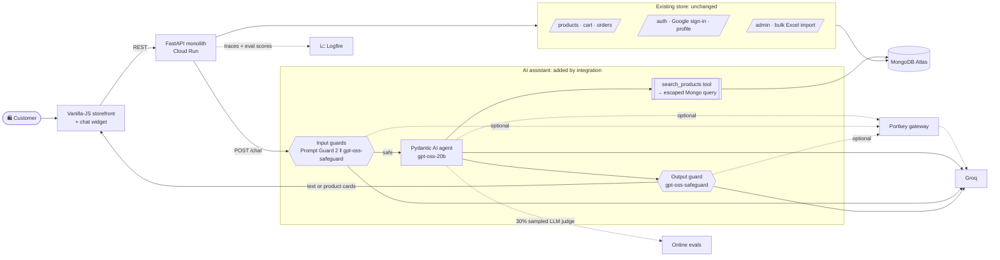
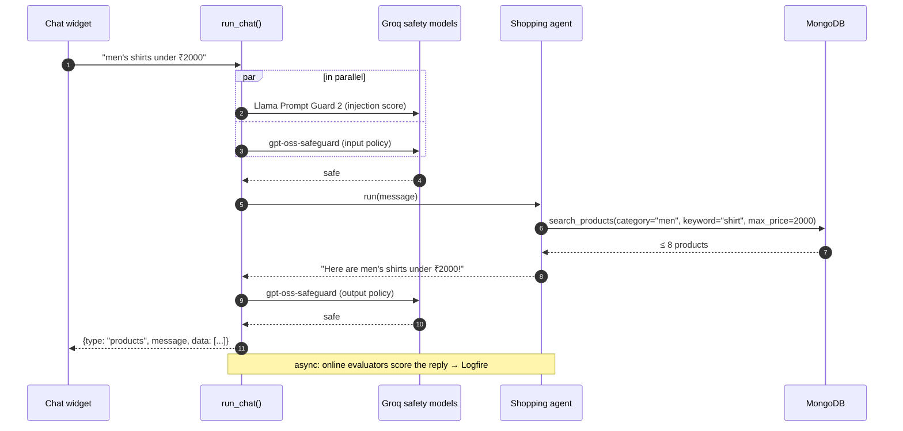
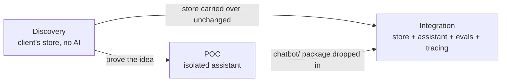

<div align="center">

# 👕 LUXE: AI Shopping Assistant for E-Commerce

**A forward-deployed AI engagement, end to end. I took a client's existing clothing store, proved an LLM shopping assistant in an isolated POC, then integrated it into production with guardrails, live evals and full tracing on Google Cloud Run.**

[](https://github.com/Abhinay1526/luxe-ai-shopping-assistant/actions/workflows/ci.yml)


</div>

---

## 📌 What this project is about

LUXE is a working online clothing store with a catalog, cart, orders, accounts, Google sign-in and an admin panel. The client asked: *"We want customers to just **talk** to the store. How?"*

This repo is the answer, delivered the way a **Forward Deployed AI Engineer** would:

| Stage | What happened |
|---|---|
| 🔍 **Discovery** | The client's app exactly as handed over. I learned the data model (4 Mongo collections), the identity model and the deployment. **No AI.** |
| 🧪 **POC** | Proved the idea **in isolation, against the real catalog**: one `POST /chat`, one tool, guardrails, a demo page. Nothing else. |
| 🚀 **Integration** *(this repo)* | Dropped the POC's `chatbot/` package into the store **unchanged**, then added live evals, an offline eval suite and end-to-end tracing. |

The POC was built as a self-contained `chatbot/` package (`agent.py`, `guardrails.py`, `pipeline.py`), so integration meant dropping it into `backend/chatbot/` **unchanged**. The store's own code stayed untouched. The commit history follows the same arc: the first commit is the client's store as handed over, and the next adds the integrated assistant.

Now a customer can type *"men's shirts under ₹2000"*. The agent turns that sentence into a safe MongoDB query and returns real product cards from the live catalog, with no filters and no menus.

---

## 🏛️ Architecture



### One chat request



### How the stages relate



---

## 🛡️ AI safety design

| Layer | Model / mechanism | Catches |
|---|---|---|
| **Input: injection** | Llama Prompt Guard 2 (86M), score ≥ 0.5 | Jailbreaks, prompt-extraction attempts |
| **Input: policy** | gpt-oss-safeguard-20b with a bring-your-own-policy prompt | Violence, self-harm, hate, sexual content, prompt extraction |
| **Tool scoping** | The agent's *only* capability is a read-only product search, and every LLM-chosen string is `re.escape`d | NoSQL/regex injection, data exfiltration |
| **Output: policy** | gpt-oss-safeguard-20b | System-prompt leaks, **unauthorized commitments** (fake discounts or refunds), jailbroken persona |
| **Grounding** | Product cards come from the DB, not the LLM's text | Hallucinated products and prices |

**Trade-off:** the guardrails *fail open*. A safety-model outage is logged and chat stays up, because for a shopping assistant availability beats strictness. Input guards run **in parallel** to keep latency down.

## 📊 Evaluation

- **Online.** Pydantic Evals evaluators attach to the live agent: non-empty reply, reply length, and an LLM judge (gpt-oss-120b, **30% sampled** to stay under Groq's rate limit). Scores stream to Logfire. Toggle with `ONLINE_EVALS_ENABLED`.
- **Offline.** `python -m backend.evals.chatbot_evals` runs 10 golden conversations against the real agent. It checks that product queries **actually invoke the tool** (verified through OpenTelemetry spans, not reply text) and that guardrails block attacks but allow merely rude messages.
- **Unit tests.** 20 offline tests with the LLM and DB mocked cover guardrail ordering, fail-open behaviour, verdict parsing, regex-injection escaping, password hashing and admin gating.

---

## 🧰 Tech stack

| | |
|---|---|
| **Backend** | FastAPI, Pydantic v2, pydantic-settings |
| **AI** | Pydantic AI agent with tool calling; Groq (`gpt-oss-20b`, `gpt-oss-safeguard-20b`, `llama-prompt-guard-2-86m`); optional Portkey gateway |
| **Evals & observability** | Pydantic Evals (online + offline), Pydantic Logfire (OpenTelemetry) |
| **Data** | MongoDB Atlas |
| **Frontend** | Vanilla JS + CSS (no build step), SPA router |
| **Auth** | bcrypt passwords, Google Sign-In (ID-token verification) |
| **Deploy** | Docker, Google Cloud Build → Artifact Registry → Cloud Run, Secret Manager |

## 📂 Repository structure

```
.
├── main.py                    # app wiring: routers, Logfire, static storefront
├── backend/
│   ├── chatbot/               # ⭐ the AI package (identical to the POC)
│   │   ├── agent.py           #    system prompt + search_products tool
│   │   ├── guardrails.py      #    input/output safety models
│   │   ├── pipeline.py        #    guards → agent → guard → response
│   │   └── online_evals.py    #    live evaluators (main only)
│   ├── evals/chatbot_evals.py # offline golden-set eval suite
│   ├── routes/                # products, cart, orders, auth, google_auth, profile, chatbot
│   └── utils/                 # mongo query helpers, passwords, images, LLM gateway
├── Frontend/                  # storefront + chat widget (components/Chatbot.js)
├── tests/                     # offline unit tests
├── demo_data/                 # sample catalog (Excel + images) for the bulk importer
├── docs/                      # story, architecture, per-layer docs, GCP deployment guides
├── Dockerfile, docker-compose.yml, cloudbuild.yaml
└── .github/workflows/ci.yml
```

## 🚀 Quick start

```bash
cp .env.example .env               # MONGO_URI + GROQ_API_KEY minimum
pip install -r requirements.txt
python main.py                     # → http://localhost:8000  (API docs at /docs)
```

```bash
docker compose up --build          # same, with a local MongoDB
pip install -r requirements-dev.txt && pytest -q    # offline tests
```

Load the sample catalog through **Admin → Bulk import** with `demo_data/bulk_upload.xlsx` and `demo_data/Imgs.zip`. Deploy to Cloud Run with [docs/07-deployment.md](docs/07-deployment.md).

## 📚 Documentation

| | |
|---|---|
| [The FDE story](docs/STORY.md) | How the three stages fit together |
| [Integration walkthrough](docs/INTEGRATION.md) | Every file the AI touches, store → main |
| [Architecture](docs/02-architecture.md) · [AI assistant](docs/06-ai-assistant.md) | Request walkthroughs, pipeline, guardrails |
| [Frontend](docs/03-frontend.md) · [Backend](docs/04-backend.md) · [Database](docs/05-database.md) | Each layer in detail |
| [Deployment](docs/07-deployment.md) · [Glossary](docs/08-glossary.md) | Google Cloud setup, terms |

## ⚠️ Known limitations and next steps

The inherited store identifies users by a **client-supplied email** (the `X-User-Email` header), with no session token. Admin routes check an `is_admin` flag, but a client can claim any email. As the FDE, I scoped the AI work **not** to change the client's auth model, and flagged it as the top follow-up:

- [ ] Replace header identity with signed JWT sessions (issue on login and Google sign-in, verify on every write route)
- [ ] Per-user rate limiting on `/chat` (Groq TPM is shared)
- [ ] Conversation memory for multi-turn refinement ("cheaper ones?")
- [ ] Vector search for fuzzy product matching ("something for a beach wedding")

## 🙏 Acknowledgements

Based on Forward Deployed Engineer course material. Restructured, hardened and extended with the test suite, CI pipeline, Docker Compose stack and documentation.
